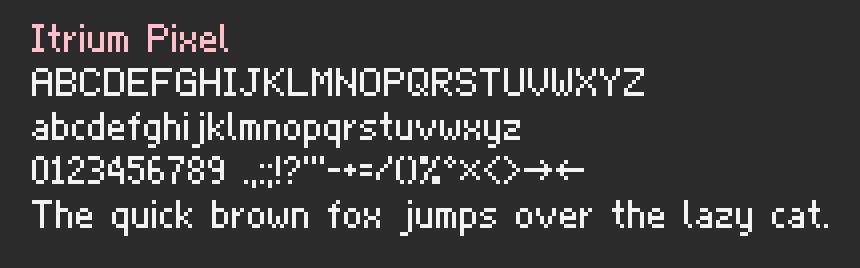

# Itrium Pixel

The pixel font Itrium's games share. Capitals and digits are 7 pixels tall, lowercase has a
5 pixel x-height, letters are proportional, and every glyph lands on whole pixels.



## Using it in a game

It's a [Godot](https://godotengine.org) 4.7 add-on. Take it in as a git submodule, which pins the
version your game uses:

```sh
git submodule add https://github.com/itriumid/pixel-font addons/itrium_pixel_font
```

Then draw with the `PixelFont` class:

```gdscript
PixelFont.draw(self, Vector2(8, 8), "Hello", Color.WHITE)
var width := PixelFont.width("Hello")
# Or as a Godot font, for buttons, labels and the rest of Godot's interface:
label.add_theme_font_override("font", PixelFont.font())
```

To take a newer version, update the submodule and commit the change in your game:

```sh
git -C addons/itrium_pixel_font pull origin main
```

## Adding or changing a glyph

Glyphs are typed by hand in `pixel_font.gd`, as rows from the top: `#` is ink, `.` is paper,
and rows are separated by spaces. Then:

```sh
# Run the tests (they check every glyph is a clean rectangle, and nothing a game prints is missing)
GODOT=/path/to/godot tools/test.sh

# Redraw the specimen above
GODOT=/path/to/godot tools/test.sh specimen
```

## License

The [SIL Open Font License, version 1.1](LICENSE), with "Itrium" as a reserved font name. You
can use, change and share the font, and embed it in anything, including games you sell; a
changed version can't be called Itrium.
